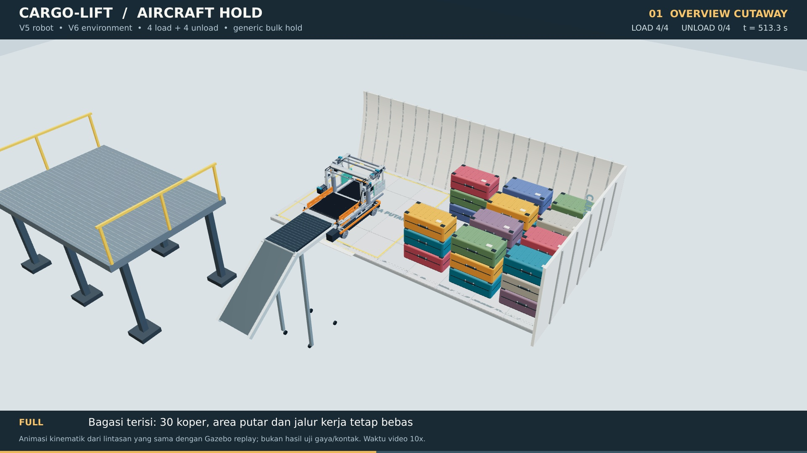

# CARGO-LIFT — bagasi pesawat, skenario v6

Robot memakai geometri **v5 open passage** yang sudah direvisi. Paket ini menambahkan ruang bagasi, akses masuk robot, empat siklus loading dan empat siklus unloading, serta video dari tiga sudut. Koper ditumpuk langsung di atas koper lain. Tidak ada rak atau platform tambahan di dalam bagasi.



## Mulai di Gazebo

Target: **Ubuntu 24.04 + Gazebo Harmonic / gz-sim8**, compiler C++17. ROS 2 tidak diperlukan untuk mode utama. Ekstrak seluruh ZIP; jangan memindahkan SDF atau mesh secara terpisah.

```bash
cd cargo_hold_v6
sudo bash install_dependencies.sh   # sekali, membutuhkan internet
bash run_gazebo.sh --speed 10        # membangun plugin lalu membuka adegan
```

Pilihan lain:

```bash
bash run_gazebo.sh --full --speed 1  # dinding dan atap utuh, waktu skenario asli
bash run_gazebo.sh --headless --speed 10
bash scripts/validate_local.sh      # kompilasi + uji inti plugin + validasi SDF
```

`--speed 1` memutar skenario selama **1.101 detik (18 menit 21 detik)** waktu simulasi. `--speed 10` mempersingkat pemutaran menjadi sekitar **110 detik** jika real-time factor mendekati 1. Setelah akhir, robot berhenti pada pose terakhir. Tutup dan jalankan ulang untuk mengulang dari awal. Nilai 10 adalah percepatan presentasi, bukan kecepatan robot fisik.

Untuk kamera Gazebo, jalankan dari terminal kedua ketika GUI sudah terbuka:

```bash
python3 scripts/set_camera.py overview
python3 scripts/set_camera.py interior
python3 scripts/set_camera.py handling
```

Gunakan world `--full` untuk pandangan dari dalam. Potongan menyeluruh adalah tampilan default. Plugin **Video Recorder** sudah disertakan pada GUI; resolusi rekamannya mengikuti ukuran viewport Gazebo. Kamera preset dan perekaman GUI belum diuji secara langsung di lingkungan pembuat paket.

## Alur yang ditampilkan

1. Robot berada di platform servis luar pada ketinggian lantai bagasi. Kepala transfer tersimpan dan pintu sudah terbuka.
2. Robot masuk menghadap +Y. Platform servis bergeser ke samping setelah robot benar-benar masuk; conveyor luar kemudian mendekat ke pintu. Gerak GSE ini merupakan ilustrasi penempatan, bukan rancangan atau simulasi dinamika kendaraan GSE.
3. Robot mundur ke docking penerimaan. Koper masuk dari sisi pintu melalui bukaan portal tanpa palang di tengah jalurnya.
4. Rahang menjepit, robot bergeser ke pusat area putar, lalu seluruh base berputar 90° menghadap +X. Mecanum membawa robot ke lajur tumpukan.
5. Lift mengatur tinggi, kepala menjulur, pelat ditarik, lalu koper dilepas ke tumpukan. Lift tetap tinggi sampai kepala bebas dari koper, kemudian robot kembali ke pintu.
6. Langkah tersebut diulang untuk **4 koper**: dua koper pada tumpukan kiri dan dua pada tumpukan kanan.
7. Pada kondisi terisi, unloading mengambil koper teratas terlebih dahulu. Micro-lift membuat celah, pelat masuk, kepala retract, dan robot kembali ke conveyor untuk reverse.
8. Setelah **4 koper dibongkar**, conveyor keluar dari jalur, platform servis kembali, dan robot keluar melalui pintu yang sama.

Koper muncul dan dihapus pada batas serah-terima conveyor luar. Transport dari permukaan apron ke segmen akhir conveyor tidak disimulasikan. Tidak ada koper yang dimunculkan langsung di tumpukan.

## Arti kondisi “penuh”

Ada **26 koper awal**, kemudian ditambah 4 koper aktif sehingga kondisi terpadat berisi **30 koper**. Tumpukan berada di area yang ditetapkan; area putar 2 × 2 m dan ruang kerja tetap bebas. “Penuh” di sini berarti bay penyimpanan skenario terisi, **bukan seluruh volume bagasi diisi tanpa lorong**. Video memperlihatkan empat contoh unloading dari kondisi tersebut; 26 koper latar tetap tersusun di akhir, bukan pembongkaran seluruh isi bagasi.

| Parameter | Nilai skenario |
|---|---:|
| Bagasi generik: panjang / lebar lantai / tinggi | 4,50 / 2,20 / 1,20 m |
| Bukaan pintu samping | 1,30 × 1,05 m |
| Koper aktif | 650 × 360 × 260 mm |
| Lapisan tumpukan maksimum | 3 |
| Koper awal / terpadat / akhir | 26 / 30 / 26 |
| Loading / unloading aktif | 4 / 4 koper |
| Model robot | v5 open passage, 71 link, 70 joint |
| Mesh visual robot | 236 kelompok warna, satuan meter |
| CAD ruang bagasi utuh | 499 solid |
| CAD ruang bagasi potongan | 378 solid |

Bentuk bagasi adalah **model teknik generik**, bukan CAD OEM Airbus/Boeing. Lebar dinding bertambah di atas lantai; angka 2,20 m adalah lebar lantai. Bukaan, struktur, pintu, daya dukung lantai, dan ruang bebas harus disesuaikan dengan pesawat yang sebenarnya.

## Apa yang benar-benar disimulasikan

**Mode utama adalah replay kinematik di Gazebo.** Plugin `ScenarioReplay` membaca lintasan waktu, lalu memperbarui pose 71 link robot, 4 koper, conveyor luar, dan platform servis. Scissor dan tahap head Z mengikuti kinematika yang sama dengan URDF. World replay sengaja tidak mengaktifkan Physics system agar skenario geometri dapat diputar deterministik.

Ini belum merupakan sistem navigasi otonom, SLAM, perencanaan pengepakan, pengendali gaya, sensor penghalang, simulasi ban mecanum yang tervalidasi, atau simulasi koper lunak. Kontak, slip, kekuatan lantai, gaya jepit dan kestabilan tumpukan tidak dibuktikan oleh replay. Koper yang sedang dibawa mengikuti transform rahang; pose koper saat penyerahan ditentukan lintasan, bukan hasil integrasi gaya.

Sumber paket riset dinamis v5 tetap tersedia di `ros2_ws/src/cargo_robot_description`. Di sana terdapat joint/inertia/collision URDF, controller, bridge, dan plugin `CargoHandling` berbasis gaya belt serta ideal grip. **Demo dinamis v5 tersebut merupakan skenario terpisah**, belum disesuaikan atau diuji end-to-end terhadap skenario 4 koper v6. Jangan mengaktifkan Physics pada world replay dan menganggapnya menjadi simulasi dinamis.

## Status pengujian

- `ScenarioReplay` dan `CargoHandling` berhasil dikompilasi dengan Gazebo Harmonic **8.15.0**, GCC 13 dan CMake.
- World SDF diparse, entitasnya dibuat melalui **SdfEntityCreator milik Gazebo**, kemudian inti plugin dijalankan pada EntityComponentManager selama seluruh skenario: **77 track, 11.011 sampel sumber, 2.203 update pengujian**.
- Posisi/rotasi yang dikeluarkan inti plugin dibandingkan dengan sumber lintasan pada checkpoint. Laporan ada di `validation/package_validation.json`.
- **2.203 sampel** pemeriksaan AABB komponen CAD terhadap koper lain tidak menemukan irisan. Koper yang sedang dijepit dikecualikan dari pemeriksaan ini; jalur payload robot telah diperiksa pada v5. Pemeriksaan diskret ini bukan bukti continuous collision-free, self-collision lengkap, atau keselamatan fisik.
- Kedua STEP diimpor ulang dalam proses OpenCascade terpisah: 499 dan 378 solid valid, volume positif, unit mm. SolidWorks tidak tersedia untuk diuji.
- **Server/GUI Gazebo belum berhasil dijalankan sampai selesai di lingkungan pembuat** karena pembatasan socket (`getifaddrs` / ZeroMQ `Operation not permitted`). Hasil uji inti plugin tidak disamakan dengan keberhasilan server/GUI.
- Video menggunakan render CAD Three.js dengan lintasan yang sama, **bukan rekaman layar Gazebo**. Frame dirender native 1920 × 1080 pada 6 frame/detik, lalu diinterpolasi temporal menjadi MP4 24 fps; waktu dipercepat 10×. Tidak ada klaim native 24 fps atau uji fisika melalui video.

## Video dan CAD

| Berkas | Isi |
|---|---|
| `video/01_Overview_HD.mp4` | Seluruh siklus, potongan menyeluruh |
| `video/02_Interior_HD.mp4` | Seluruh siklus, dari pintu dan dalam kabin |
| `video/03_Robot_Follow_HD.mp4` | Seluruh siklus, kamera mengikuti robot |
| `cad/Bagasi_Pesawat_Generic_Full.step` | Enclosure utuh dengan pintu terbuka, lantai, rangka, lampu, titik pengikat |
| `cad/Bagasi_Pesawat_Generic_Cutaway.step` | Versi potongan untuk pemeriksaan gerak |

STEP memakai mm; URDF, STL dan SDF memakai meter. Mesh robot untuk Gazebo tetap menggunakan resolusi penuh. Renderer HD menggunakan pengelompokan vertex sekitar 1 mm untuk mempercepat visualisasi; sumber CAD/mesh robot tidak diubah.

## Isi program dan perubahan

- `cargo_robot.urdf`: URDF mandiri dengan jalur mesh relatif ke `models/`; buka bersama seluruh folder agar mesh ditemukan.
- `run_gazebo.sh`, `install_dependencies.sh`, `CMakeLists.txt`: jalur utama install/build/run.
- `src/ScenarioReplay.cc`: plugin replay; `src/ReplayEcmCheck.cc`: pengujian inti pada world SDF nyata.
- `worlds/`: bagasi utuh dan potongan. Semua mesh lokal; tidak membutuhkan Fuel download.
- `models/`: robot v5, ruang bagasi, dan koper detail.
- `config/scenario.json`: fase, pose base, joint, koper dan GSE; sumber bersama video dan Gazebo.
- `config/trajectory.csv`, `tracks.txt`: pose SI tersampel untuk plugin. File sudah disertakan sehingga menjalankan Gazebo tidak membutuhkan CadQuery/Python scientific stack.
- `scripts/build_scenario.py`, `sample_scenario.py`, `kinematics.py`: pembangun lintasan.
- `scripts/build_world.py`: pembangun model koper dan world.
- `cad/build_hold.py`: sumber parametrik STEP ruang bagasi.
- `render/`: sumber renderer, dependency lock dan encoder video.
- `ros2_ws/`: paket ROS 2 Jazzy v5 sebagai dasar pengembangan lebih lanjut; bukan syarat menjalankan replay.
- `validation/`: bukti pengujian, batas cakupan, metadata video dan STEP.

Jika dimensi atau urutan diubah, regenerasikan lintasan dan lakukan ulang pemeriksaan:

```bash
python3 -m venv .venv
source .venv/bin/activate
pip install -r requirements-authoring.txt
python cad/build_hold.py
python scripts/build_scenario.py
python scripts/build_world.py
python scripts/sample_scenario.py
python scripts/validate_scenario.py
bash scripts/validate_local.sh
python scripts/validate_package.py
```

Untuk render ulang video: install Node.js dan FFmpeg, lalu:

```bash
cd render
npm ci
npx playwright install --with-deps chromium
npm run build
node capture.cjs overview full
node capture.cjs interior full
node capture.cjs tracking full
python3 encode_video.py overview
python3 encode_video.py interior
python3 encode_video.py tracking
```

Capture bisa melanjutkan frame yang sudah ada. **Hapus folder `render/frames_*` sebelum render ulang jika skenario, model atau kode visual diubah**, agar frame lama tidak tercampur.

Alternatif container:

```bash
docker build -t cargo-hold:v6 .
docker run --rm --network host cargo-hold:v6
```

Dockerfile disertakan sebagai alternatif headless dan belum dibangun/diuji di lingkungan ini. Tampilan GUI di Docker memerlukan konfigurasi display host sendiri. Untuk pengguna Windows, jalankan Gazebo melalui Ubuntu 24.04/WSLg atau mesin Linux; MP4 dan STEP dapat dibuka langsung tanpa Gazebo.

## Spesifikasi robot yang tetap digunakan

Payload rancangan 32 kg; estimasi massa kosong 196 kg; robot home sekitar 1195 × 791 × 805 mm. Penggerak menggunakan empat servo 48 V / 200 W dengan gearbox 20:1, lift 750 W, head Z 750 W, serta aktuator conveyor, yaw, extension, rahang dan pelat seperti v5. Rincian lengkap ada di `config/robot_v5_specifications.json`.

Baterai acuan tetap **48 V 30 Ah**: estimasi v5 sekitar **2,26 jam** pada duty-cycle referensi, rentang **1,42–3,41 jam**. Angka ini bukan hasil pengukuran baterai, bukan estimasi baru dari video v6, dan bukan konsumsi daya dari replay Gazebo.

## Referensi primer

- Instalasi Harmonic: https://gazebosim.org/docs/harmonic/install_ubuntu/
- Arsitektur sistem/physics: https://gazebosim.org/docs/harmonic/architecture/
- Kamera Gazebo GUI 8: https://gazebosim.org/api/gui/8/classplugins_1_1CameraTracking.html
- Video Recorder Harmonic: https://gazebosim.org/api/sim/8/videorecorder.html
- Leadshine 200 W: https://www.leadshine.com/network-detail/integrated-servo-motor/servo/iSV2-CAN6020V48G.html
- Leadshine 750 W: https://www.leadshine.com/network-detail/fieldbus/CANopen/c-integrated-servo-motors/iSV2-CAN8075V48G.html

Model bagasi, lintasan dan gambar dalam paket dibuat untuk konsep ini. Referensi aktuator bukan CAD OEM tersertifikasi. Lisensi pustaka visual ada di `third_party/`.
